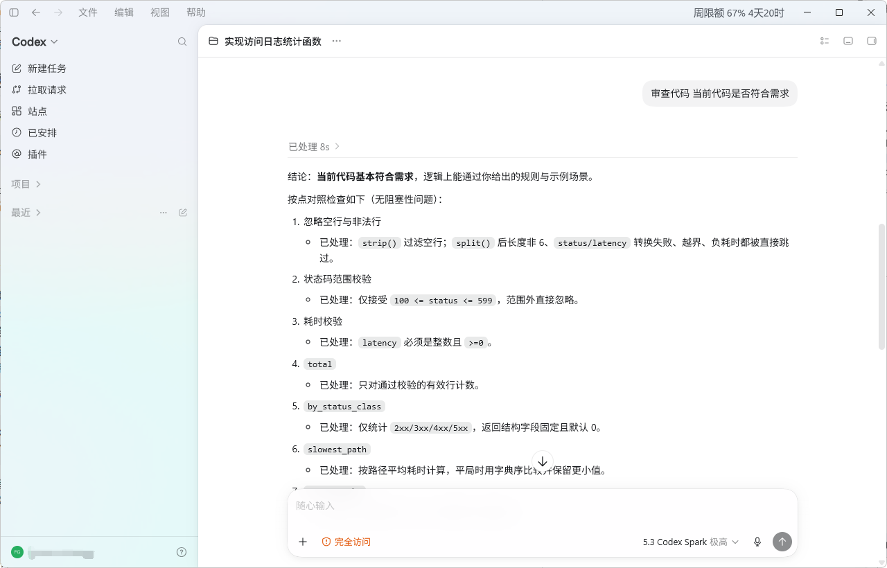

# CodexPlus

> 常驻在 Windows 通知区域，在前台 Codex 窗口标题栏右侧以中文 overlay 显示 **5 小时与周限额的剩余额度** 与倒计时。

<table>
  <colgroup>
    <col style="width: 18%">
    <col style="width: 82%">
  </colgroup>
  <thead>
    <tr><th align="left">项目</th><th align="left">内容</th></tr>
  </thead>
  <tbody>
    <tr><td>平台</td><td>Windows 10 / 11（x64）</td></tr>
    <tr><td>形态</td><td>单 EXE、原生 Win32；无 WebView2、Node.js、Python 或 PowerShell 运行时</td></tr>
    <tr><td>数据</td><td>只读 Codex CLI 的 <code>auth.json</code>；仅请求固定 <code>wham/usage</code> endpoint</td></tr>
    <tr><td>隐私</td><td>Token、账号、代理 URL 与代理凭据不写入缓存、诊断报告或 UI</td></tr>
    <tr><td>界面</td><td>用户可见界面（标题栏 overlay、托盘菜单/提示、设置窗口、错误状态）全部为简体中文；技术诊断日志保持英文便于检索</td></tr>
  </tbody>
</table>

## 效果预览



打开 Codex 桌面窗口并置于前台时，标题栏最小化按钮左侧会出现中文 overlay，
显示剩余百分比与重置倒计时；当窗口被覆盖或最小化时随之隐藏。

## 功能

- **标题栏 overlay**：当前台窗口被识别为 Codex 时，在标题栏最小化按钮左侧显示中文用量条，例如 `5小时 58% 1时18分   周限额 75% 5天14时`。百分比为剩余额度；服务端只返回单个窗口（当前只返回周限额）时，只会显示 `周限额 75% 5天14时`。无缓存数据时显示 `Codex 用量 · 加载中…` 或 `Codex 用量 · 暂不可用`，不会静默消失。
- **抗锯齿渲染**：Overlay 在 3 倍离屏分辨率下绘制文字，再用灰度覆盖率下采样，避免透明分层窗口上常见的 ClearType 彩边和阶梯状边缘。
- **贴近标题栏、右对齐**：文字以右对齐贴在最小化按钮左侧，14 DIP 字号、Segoe UI Variable Text 字体；不再全局置顶，鼠标点击穿透，不抢焦点、不出现在任务栏或 Alt+Tab。
- **失焦跟随**：当 Codex 窗口可见且未最小化时始终显示；其他应用覆盖 Codex 窗口时，overlay 会随 Codex 被覆盖。
- **托盘常驻**：启动后保留通知区域图标（图标来自 EXE 自带的 `assets/app.ico`）。右键菜单提供 `刷新`、`显示/隐藏标题栏`、`设置`、`诊断`、`退出`，菜单和 tooltip 均为中文。
- **后台刷新与缓存**：默认每 300 秒请求一次；网络或协议异常时保留最近成功快照并标记为 stale（灰色 + `!`）；认证问题会降低刷新频率。缓存 schema 兼容 v1/weekly-only 等历史格式。
- **单窗口兼容**：服务端在 5 小时窗口被临时下线、只返回周限额时仍可正确分类与显示；不会出现协议错误。
- **设置窗口（浅色现代风格）**：原生 Win32 窗口，可开关 overlay、设置 60–3600 秒刷新周期、切换额度显示模式（剩余/已用）与重置时间显示模式（倒计时如 `5天14时` / 到期时间如 `7月30日 19:34`），并选择环境代理、强制直连或自定义代理；输入框、按钮与背景颜色清晰区分。

## 快速开始

### 1. 登录 Codex CLI

```powershell
npm install -g @openai/codex
codex login
Test-Path $env:USERPROFILE\.codex\auth.json
```

`auth.json` 也可位于 `%CODEX_HOME%\auth.json`。CodexPlus 只读取其中的 access token，不会修改它，也不读取 `OPENAI_API_KEY` 或 refresh token。

### 2. 构建并启动

```powershell
cargo build --release
.\target\release\codexplus.exe
```

进程会在后台常驻；请在 Windows 通知区域找到图标（应用图标）。打开或切换到 Codex 桌面窗口时，符合条件的标题栏会显示 overlay。右键托盘图标打开中文菜单；选择 **退出** 才会停止进程并移除图标。

### 3. 卸载

退出 CodexPlus 后删除 EXE；如需清除本地设置和快照：

```powershell
Remove-Item "$env:LOCALAPPDATA\CodexPlus" -Recurse -Force
```

这不会修改 Codex 的 `auth.json`。如果之前在更老的版本中使用过自定义代理，它会保留在 Windows Credential Manager 中名为 `CodexPlus.ProxyUrl.v1` 的条目，可按需手动删除（与新版配置无关）。

## 设置与网络代理

非敏感设置保存在：

```text
%LOCALAPPDATA%\CodexPlus\settings.json
```

该文件保存 overlay 开关、刷新周期、代理模式和自定义代理地址。用量快照单独保存至 `usage-cache.json`。代理地址是桌面本机配置，会被明文持久化到 `settings.json`，设置窗口重新打开时会再次显示。

### 代理模式

在 **设置** 中选择：

1. **使用环境代理**：读取启动进程的环境变量，优先级为 `CODEXPLUS_HTTPS_PROXY` → `HTTPS_PROXY` → `https_proxy` → `HTTP_PROXY` → `http_proxy` → 直连。空值会跳过。
2. **强制直连**：忽略所有代理环境变量，直接连接固定 endpoint。
3. **使用自定义代理地址**：在地址框输入 `http://` 或 `https://` 代理地址后保存；地址会显示在配置文件中，运行时原样使用。

环境代理示例：

```powershell
$env:CODEXPLUS_HTTPS_PROXY = 'http://127.0.0.1:7890'
.\target\release\codexplus.exe
```

代理仅影响固定的 `wham/usage` 请求；不会改变 endpoint、不会修改 Codex 登录状态，也不会把地址或凭据写入诊断报告或错误文案。

### 代理模式

在 **设置** 中选择：

1. **使用环境代理**：读取启动进程的环境变量，优先级为 `CODEXPLUS_HTTPS_PROXY` → `HTTPS_PROXY` → `https_proxy` → `HTTP_PROXY` → `http_proxy` → 直连。空值会跳过。
2. **强制直连**：忽略所有代理环境变量，直接连接固定 endpoint。
3. **使用自定义代理地址**：保存 `http://` 或 `https://` 代理地址到 Credential Manager，之后不再回显地址。

环境代理示例：

```powershell
$env:CODEXPLUS_HTTPS_PROXY = 'http://127.0.0.1:7890'
.\target\release\codexplus.exe
```

代理仅影响固定的 `wham/usage` 请求；不会改变 endpoint、不会修改 Codex 登录状态，也不会把地址或凭据写入缓存。

## 用量状态

- Overlay 显示的是剩余百分比（与可继续使用的额度一致），告警色仍按服务端返回的已用比例判断：剩余 ≥ 30%（已用 < 70%）为默认色；已用 ≥ 70% 为橙色；已用 ≥ 90% 为红色；stale 为灰色并带 `!`。可在设置里切换为「已用额度」显示（如 `周限额 25%`），颜色阈值不变。
- 当缓存和实时数据都不可用时，显示 `Codex 用量 · 暂不可用`，这是真实状态，不会被替换为伪造的 0% 或 100%。
- 托盘 Tooltip 的示例：`CodexPlus / 周限额：剩余 75%，5天14时后重置 / 更新于 12:34`。

## 目标窗口识别

默认会匹配 Codex 相关的可执行文件名；如果你的桌面应用 host 名称不同，可在启动前设置逗号分隔的 basename 覆盖：

```powershell
$env:CODEXPLUS_TARGET_BIN = 'codex.exe,chatgpt.exe'
.\target\release\codexplus.exe
```

这项覆盖只影响当前启动进程。状态条仅会附着到 Codex 窗口可见且未最小化时；窗口被覆盖、最小化、不可见或标题栏可用宽度不足时会隐藏。最大化窗口可以显示。不同安装包、窗口类、主题或无边框全屏模式仍可能影响标题栏定位；如未匹配，请先运行诊断，确认前台窗口的实际 exe basename 后再设置该变量。

## 诊断

使用 `--diagnose` 执行一次凭据、缓存和实时请求检查：

```powershell
.\target\release\codexplus.exe --diagnose
```

诊断使用与当前 Settings 相同的代理模式，成功的实时请求会更新 last-good 缓存，并将报告写入 `%TEMP%\codexplus-diagnose-*.log`。结束后会显示报告路径。

报告会记录凭据文件存在性、缓存读取结果、代理**来源标签**、请求结果、ViewState 摘要（英文 used 语义，方便检索历史日志），以及 overlay 目标识别结果（有效 exe basename、前台窗口 exe/class、是否匹配并具备显示资格）。请求成功时会记录两个窗口的实际 `limit_window_seconds`；协议错误（例如 `WindowDurationMismatch`）会同时记录窗口角色、actual/expected duration 与允许范围，便于判断当前 CodexPlus 是否还应接受该响应。排查“没有状态条”时，请先把 Codex 窗口置于前台再运行诊断。报告不会记录 token、账号 ID、Authorization header、代理地址、代理用户名/密码、响应 body、API 原文、窗口标题或完整进程路径。

## 构建与验证

```powershell
cargo fmt
cargo fmt --check
cargo check --all-targets
cargo test --lib
cargo test --release --lib
cargo clippy --all-targets --all-features -- -D warnings
cargo build --release
```

Windows 手动验收建议：

1. 启动后确认进程持续运行且托盘图标存在（应用图标风格）。
2. 检查右键菜单的 `刷新`、`显示标题栏`、`设置`、`诊断`、`退出`。
3. 打开 Codex 窗口，确认标题栏右侧出现 `5小时/周限额 xx% xx天xx时` 形式的中文 overlay，且鼠标点击标题栏不会激活 overlay。
4. 把另一窗口覆盖在 Codex 之上，确认 overlay 随之被覆盖；当 Codex 重新可见后 overlay 自动恢复。
5. 修改刷新周期和代理模式，退出并重新启动，确认设置仍生效；分别验证环境、直连和自定义代理；检查诊断日志只含安全代理标签。
6. 使用 `退出`，确认托盘图标消失且进程结束。

## 安全边界

| 数据 | 处理 |
|---|---|
| `auth.json` access token | 只用于请求 Authorization header；不进缓存、日志或错误文案 |
| account ID | 仅用于请求头；不落本地 |
| 自定义代理 URL | 作为桌面配置保存在 `settings.json`，可随时修改；不进日志、缓存或诊断报告 |
| API 响应原文 | 不保存 |
| Endpoint | 固定为 `https://chatgpt.com/backend-api/wham/usage`；不读取自定义 base URL，不跟随重定向 |
| 缓存 schema | 当前 v2，向前兼容 v1；无法识别的快照会被忽略，不会写入错误数据 |
| 设置 schema | v2（自定义代理地址持久化），旧 v1 仍能读取，但回显前会按 schema_version 安全回退 |

## 当前范围

- 不提供自动更新、开机启动或多 Codex 账号切换。
- 不抓浏览器页面、不读 cookie、不调用 `codex exec`。
- `wham/usage` 是内部接口；schema 变化时会显示协议错误，不会回退为伪造的 0% 或 100%。
- Overlay 的位置与显隐会周期性协调；未接入更细粒度的 WinEventHook 监听。
- 当前 overlay 文案固定为简体中文，不提供英文/i18n 选项。

## 许可证

MIT License。本项目独立实现，和 `@openai/codex` 的协议无关。
